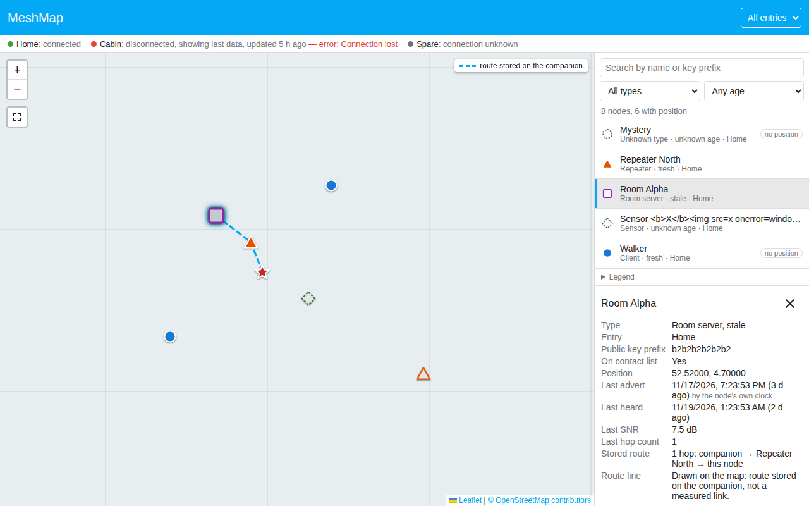

# MeshMap


MeshMap is a Home Assistant integration that shows the contacts of the [MeshCore integration](https://github.com/meshcore-dev/meshcore-ha) on a map in the sidebar. It reads the contacts MeshCore already has and sends nothing over the radio.

## Features

* Sidebar map of every MeshCore contact that advertises a position, plus the companion.
* Markers by node type: client, repeater, room server, sensor.
* Fresh and stale nodes are drawn differently, based on the last advert and the last message heard.
* Node list with search and filters by type and age, including nodes without a position.
* Node details: type, key prefix, last advert, last heard, SNR and hop count of the last message.
* Draws the route the companion has stored to the selected node when every hop matches one known node.
* Supports more than one MeshCore companion.
* Follows the Home Assistant theme and works on phones.



## Requirements

* Home Assistant 2026.11 or newer.
* The [MeshCore integration](https://github.com/meshcore-dev/meshcore-ha) 3.0 or newer, set up with at least one companion.

## Install

1. In Home Assistant, open **Settings > Marketplace**.
2. Add this repository as a custom repository of type **Integration**:

   ```text
   https://github.com/genepool99/hameshmap
   ```

3. Install **MeshMap**.
4. Restart Home Assistant.
5. Open **Settings > Devices & services**, select **Add integration** and choose **MeshMap**.
6. Open **MeshMap** from the sidebar.

## Configuration

Open **Settings > Devices & services > MeshMap > Configure**.

| Option | Default | Description |
| --- | --- | --- |
| `entries` | all | MeshCore companions shown on the map. Empty shows all, including companions added later. |
| `stale_after_hours` | `24` | A node is stale when its last advert and last message are both older than this. 1 to 720. |
| `refresh_seconds` | `60` | How often the contact list is read from MeshCore. 15 to 3600. |
| `tile_url` | `https://tile.openstreetmap.org/{z}/{x}/{y}.png` | Map tile URL with `{z}`, `{x}` and `{y}`. |
| `tile_attribution` | `© OpenStreetMap contributors` | Attribution text shown on the map. |

Map tiles are loaded by your browser directly from the tile server, which sees your IP address and the area you view. Node data is not sent to it.

## Usage

* Select a node in the list or on the map to see its details. The list and the map stay in sync.
* Use the search box and the type and age filters to narrow the list and the map.
* Use the frame button on the map to fit all nodes.
* With more than one companion, use the selector in the header to show one or all.

### What the map shows

| Item | Source | Notes |
| --- | --- | --- |
| Node position | Position advertised by the node | Nodes that advertise no position are listed as "no position". |
| Last advert | Time in the node's advert | Uses the node's own clock. |
| Last heard, SNR, hop count | Last message Home Assistant received from the node | Kept in memory. Cleared when Home Assistant restarts. |
| Route line | Route stored on the companion for the selected node | Not a measured link. Drawn only when every hop matches exactly one known node with a position. |

MeshMap does not show measured links between nodes, a full network topology or coverage. MeshCore does not provide that data to other integrations.

## Uninstall

1. Open **Settings > Devices & services > MeshMap** and delete the integration.
2. Open **Settings > Marketplace**, select **MeshMap** and uninstall it.
3. Restart Home Assistant.

MeshMap stores no data outside its configuration entry.

## Troubleshooting

**MeshMap is not in the list of integrations**
Restart Home Assistant after the install, then clear the browser cache.

**"Set up the MeshCore integration first"**
Add the MeshCore integration and a companion first, then add MeshMap.

**No nodes on the map**
Nodes appear only when they advertise a position. Check the node list: nodes marked "no position" are known but cannot be placed.

**Map background is blank**
The tile server is not reachable or refuses the requests. Set another `tile_url` in the options.

**A route says it cannot be drawn**
A hop of the stored route matches no known node, more than one known node, or a node without a position.

## Development

```sh
make test      # Python tests (docker) and panel tests (Node.js 22 or newer)
make frontend  # rebuilds the panel bundle after changes in frontend/src
make lint      # ruff
```

## License

GPL-3.0. See [LICENSE](LICENSE). The panel bundle includes [Leaflet](https://leafletjs.com) (BSD-2-Clause).
